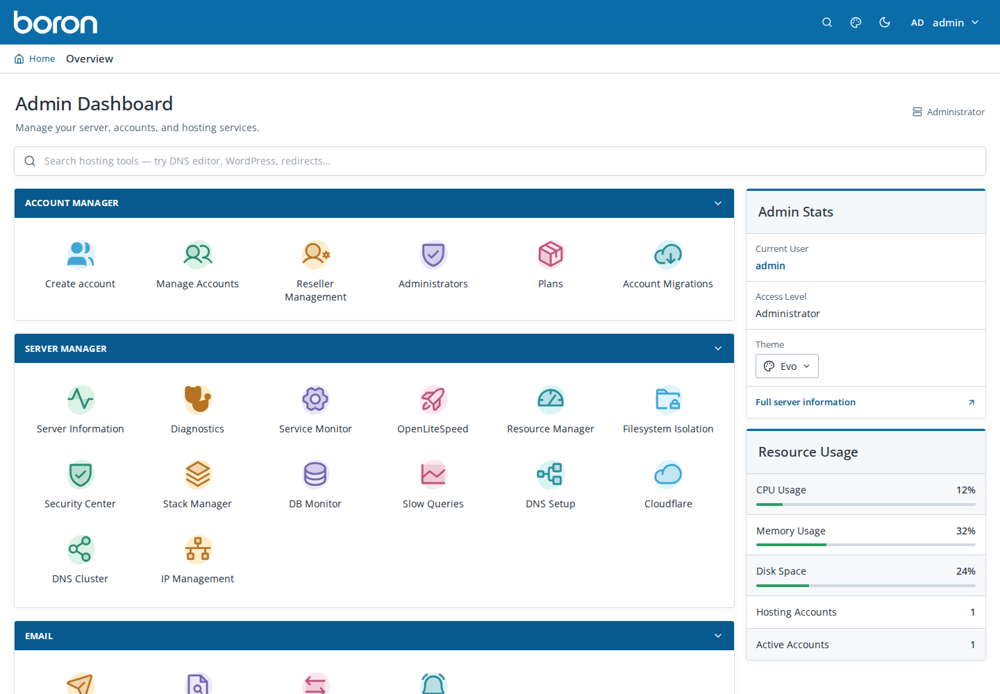
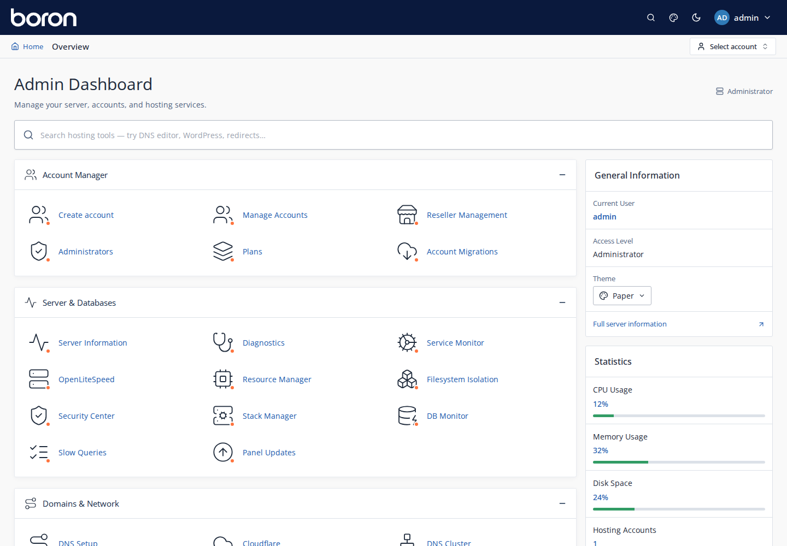
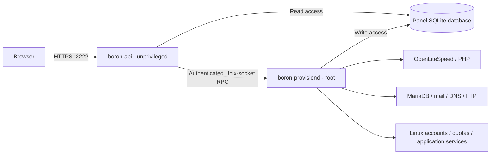

<div align="center">
  

# Boron Panel

**Your server. Your hosting. One control panel.**

A self-hosted control panel for websites, email, databases and applications on Ubuntu.
Familiar hosting workflows for administrators, resellers and customers.

[Get started](#installation) · [Explore features](#features) · [Documentation](#documentation) · [Releases](https://github.com/adityavs5/boronpanel/releases) · [Changelog](CHANGELOG.md)

**OpenLiteSpeed · FastAPI · React · MariaDB · PowerDNS · Postfix & Dovecot**

</div>

---

## Built for hosting

Boron brings everyday server and customer operations into one interface: create an account, connect a domain, install WordPress, manage mailboxes and restore a backup. It is designed as an alternative to DirectAdmin and cPanel, with a familiar organization of hosting tools.

- **Two interfaces, one panel.** Evo offers a compact, DirectAdmin-inspired experience; Paper follows the roomier cPanel style. Both support light and dark modes.
- **Separate workspaces.** Administrators manage the server, resellers manage their assigned accounts, and customers work within their own hosting account.
- **Standard services.** Websites, mail, DNS and databases run on established Linux components, with configuration and data stored on your server.
- **Account-level controls.** Linux users, resource limits and scoped operations separate hosted accounts. Web/PHP isolation is distinct from SSH/SFTP access.
- **Signed updates.** Install published releases from the panel, inspect progress and return to a compatible previous version.

## Theme previews

Dashboard captures with sample data. Both themes support light and dark modes;
these previews show an earlier UI revision, so current page styling may differ.

| Evo | Paper |
|---|---|
|  |  |

## Features

Availability depends on the installation profile and configured services.

| Area | What you can manage |
|---|---|
| **Accounts & resellers** | Hosting plans, account creation, reseller plans, quotas, suspension, customer impersonation and branding |
| **Domains & websites** | Domains and subdomains, document roots, PHP versions, redirects, maintenance mode, error pages and SSL certificates |
| **WordPress** | Guided installation, site inventory, one-click login, plugins and themes, backups and staging clones |
| **Email** | Mailboxes, quotas, forwarders, autoresponders, spam filtering, email DNS records, Roundcube integration and IMAP migration |
| **Databases** | MariaDB databases and users, grants, phpMyAdmin access, database monitoring and slow-query tools |
| **DNS** | Local PowerDNS zones, Cloudflare integration, DNS templates and cluster synchronization |
| **Files & applications** | FileBrowser, FTP over TLS, SSH keys, terminal access, cron, Git, Node.js, Python and Redis |
| **Backups & recovery** | Scheduled jobs, account and component backups, incremental snapshots, restore workflows and local or remote destinations |
| **Security & operations** | Firewall rules, IP controls, fail2ban, WAF tools, malware scanning, filesystem isolation and resource monitoring |
| **Diagnostics & automation** | Audit/error logs, task history, diagnostics, support bundles, API tokens, webhooks and notifications |
| **Account migration** | DirectAdmin server migration and DirectAdmin/cPanel archive import workflows |

Explore the [administrator guide](docs/ADMIN-GUIDE.md), [customer guide](docs/CUSTOMER-GUIDE.md) and [WordPress Manager guide](docs/WORDPRESS-MANAGER.md).

## Installation

### Requirements

Use a **fresh Ubuntu 24.04 LTS server** with root access. The installer configures system packages, services, users and firewall rules.

| Requirement | Details |
|---|---|
| Operating system | Ubuntu 24.04 LTS, x86-64 |
| Memory | Installer minimum: 1 GiB; allow more for the full stack and hosted workloads |
| Storage | At least 10 GiB free on `/`, plus capacity for websites, mail and backups |
| Access | Root or unrestricted `sudo`; provider console access for recovery |
| Network | Public IP and outbound package/download access |
| Hostname | Recommended for trusted panel TLS and webmail; DNS must point to the server |

### Install a release

Run this one line in a **root shell** on a fresh Ubuntu 24.04 server with `curl` installed:

```bash
curl -fsSLo install.sh https://raw.githubusercontent.com/adityavs5/boronpanel/master/install.sh && bash install.sh
```

The launcher downloads the pinned **v3.2.0 source tag** and runs its existing installer. It defaults to the full profile, keeps interactive prompts connected to your terminal, and removes its temporary checkout when finished. Run it in an empty working directory; the download writes `install.sh` there. If `curl` is missing, install it with `apt-get update && apt-get install -y curl ca-certificates` first.

<details>
<summary>Manual source checkout / inspect before installing</summary>

```bash
sudo -i
umask 022
apt-get update
apt-get install -y git ca-certificates
git clone --depth 1 --branch v3.2.0 https://github.com/adityavs5/boronpanel.git /root/boron-install
cd /root/boron-install
bash scripts/install.sh --profile full
```

Release runtime archives are intended for the panel updater; fresh installs use the source checkout to build the frontend.

</details>

The installer collects the panel hostname, administrator email and credentials, with an optional MaxMind license for geographic statistics. It installs the selected components, builds the UI, creates configuration and starts the panel. Cloudflare is optional; configure it later through the panel.

### Choose a profile

| Profile | Included capabilities |
|---|---|
| `minimal` | Web hosting, PHP and SSL; no hosted database, mail or DNS service |
| `standard` | Web/PHP/SSL plus MariaDB, DNS, mail, FTP and fail2ban |
| `full` — default | Standard plus application runtimes, Redis tooling, WordPress tools, backups, WAF, malware and geographic-statistics tooling |

Append a profile to the one-liner’s final command, for example `bash install.sh --profile standard`. From a source checkout, use `bash scripts/install.sh --profile standard`. Component availability does not mean every feature is enabled or fully configured: webmail needs a hostname, GeoLite2 needs a license, and backup destinations need setup.

For prerequisites, unattended installation options and verification steps, see the [fresh-install checklist](docs/FRESH-INSTALL-CHECKLIST.md). The installer's `--help` describes its current flags and environment variables. Keep passwords and tokens out of shell history and repository files.

### First login

Open the URL printed by the installer:

```text
https://<panel-hostname-or-server-ip>:2222/app/login
```

Sign in with the administrator credentials created during installation, then open **Server Setup** to review DNS, hostnames, TLS and the remaining configuration.

The initial HTTPS certificate is a bootstrap certificate. Configure a hostname and issue a trusted certificate through the panel's TLS workflow.

Before adding customer data:

1. Confirm server and service health.
2. Configure DNS and verify the relevant hostname records.
3. Review mail, webmail and notification settings if those services are installed.
4. Configure a backup destination and test a backup and restore.
5. Create a disposable hosting account and check its website, files and required services.

## Updates & recovery

Use **Panel Updates** in the administrator interface to check for a release, review the available version and start an update.

The updater downloads release assets, checks the archive checksum and trusted **Ed25519 publisher signature**, takes a control-plane backup, stages the new version, applies migrations and completes the version switch with service and health checks. History records the result and progress of each operation.

Normal discovery follows the configured repository's latest normal release; GitHub prereleases are excluded. Rollback is subject to schema compatibility. Compatible additive database changes can remain when returning to the previous code version.

Keep an independent recovery copy of your hosted data as well as the panel configuration and database. A panel update backup is not a replacement for account backups.

- [Release process](docs/RELEASING.md)
- [Schema compatibility and migrations](docs/SCHEMA-MIGRATIONS.md)
- [Control-plane disaster recovery](docs/CONTROL-PLANE-DISASTER-RECOVERY.md)

## Architecture & isolation



The API handles HTTP, authentication and the UI. Privileged operations pass through the provisioning daemon, which applies account and authorization checks before managing host resources. Infrastructure credentials are stored separately from the API session secret and application code.

Web/PHP workloads use the supported namespace-isolation layer. SSH/SFTP and terminal access have separate boundaries based on account identity, Linux permissions and resource controls; they do not carry the same private-namespace promise. Live PHP isolation checks may be **not verifiable** until a worker is running.

MariaDB is a shared server with account-specific grants. The Ubuntu package series supplies its version; separate per-account database servers are not provided.

See [Architecture](docs/ARCHITECTURE.md), [isolation notes](docs/NAMESPACE-ANSWERS.md) and [PHP controls](docs/PHP-CONTROLS.md) for implementation details and limits.

## Operations

### Useful commands

```bash
# Panel service health
sudo systemctl is-active boron-api boron-provisiond

# Follow panel service logs
sudo journalctl -u boron-api -u boron-provisiond -f

# Local health check with the bootstrap self-signed certificate
curl --fail --silent --show-error --insecure https://127.0.0.1:2222/healthz

# Inspect firewall policy
sudo ufw status verbose
```

Use normal certificate verification when checking a hostname with trusted TLS. FileBrowser runs as `boron-filebrowser-ui` and per-account `boron-filebrowser@<username>` services.

### Runtime paths

| Path | Purpose |
|---|---|
| `/opt/boron` | Active application and Python environment; becomes a version-directory symlink during updates |
| `/etc/boron/boron.toml` | Panel configuration |
| `/etc/boron/secrets.env` | Root-only infrastructure credentials |
| `/etc/boron/api-secrets.env` | API session secret |
| `/var/lib/boron/boron.db` | Panel SQLite database |
| `/var/lib/boron/backups` | Default backup storage; destinations are configurable |
| `/var/backups/boron` | Pre-update control-plane backups |
| `/var/log/boron` | Panel and job logs; service output is also available in the journal |
| `/run/boron/provisiond.sock` | Local privileged RPC socket |

The default panel port is **2222**. OpenLiteSpeed WebAdmin uses **7080**. Other listeners depend on the installed profile; consult [Panel ports](docs/PANEL-PORTS.md) and the actual firewall rules.

## Development

Use an isolated development environment. Privileged integration tests and the installer manage real Linux users, services and filesystems; run those on a disposable Ubuntu VM.

Requirements: Python 3.12 and a frontend-compatible Node version (`^20.19.0` or `>=22.12.0`, as declared in `frontend/package.json`).

```bash
git clone https://github.com/adityavs5/boronpanel.git
cd boronpanel

python3 -m venv .venv
. .venv/bin/activate
python -m pip install -r requirements.txt

cd frontend
npm ci
npm run build
cd ..

# Focused checks while developing
scripts/test.sh targeted tests/test_validation.py
scripts/test.sh quick

# Complete backend suite in the prepared test environment
scripts/test.sh full
```

`static/dist/` is generated from frontend source. The test harness uses `/srv/bt` by default, with a size guard, free-space floor and retained-run limit. Full/release runs require a test filesystem separate from panel data and logs unless an explicit override is supplied. Prepare the workspace before running the suite; see [Testing](docs/TESTING.md) and [CI](docs/CI.md).

When reporting a bug, include the panel version, reproduction steps and error reference if available. Remove credentials, tokens and private customer data from screenshots and logs. Keep proposed changes focused and describe how they were verified.

## Documentation

| Start here | Specialized guides |
|---|---|
| [Fresh installation](docs/FRESH-INSTALL-CHECKLIST.md) | [Panel TLS](docs/PANEL-TLS.md) · [Ports](docs/PANEL-PORTS.md) |
| [Administrator guide](docs/ADMIN-GUIDE.md) | [DirectAdmin server migration](docs/DIRECTADMIN-SERVER-MIGRATION.md) · [Backup compatibility](docs/DIRECTADMIN-BACKUP-COMPATIBILITY.md) |
| [Customer guide](docs/CUSTOMER-GUIDE.md) | [WordPress](docs/WORDPRESS-MANAGER.md) · [phpMyAdmin](docs/PHPMYADMIN.md) |
| [Architecture](docs/ARCHITECTURE.md) | [Isolation](docs/NAMESPACE-ANSWERS.md) · [PHP controls](docs/PHP-CONTROLS.md) |
| [Testing](docs/TESTING.md) · [CI](docs/CI.md) | [Incremental backups](docs/INCREMENTAL-BACKUPS.md) · [Disaster recovery](docs/CONTROL-PLANE-DISASTER-RECOVERY.md) |
| [Releases](docs/RELEASING.md) · [Changelog](CHANGELOG.md) | [Schema migrations](docs/SCHEMA-MIGRATIONS.md) · [Themes](docs/THEMES.md) |

## License

A project-wide license has not yet been declared in this repository. Third-party software, libraries and brand assets retain their respective licenses and trademarks.

## Branches

- **`master`** — stable source branch and the default GitHub branch.
- **`development`** — ongoing development before promotion.
- **`beta`** — changes staged for beta review.

Branches are separate from published releases. The installer remains pinned to a published version; switching branches does not publish a release or change the panel update channel.
